# IaC Lab: Automating Infrastructure with Terraform and Ansible


A homelab project that builds a small, scalable web tier entirely from code. Terraform provisions identical Ubuntu web servers in VirtualBox, Ansible turns them into hardened nginx hosts, and a single PowerShell script ties provisioning, configuration, and HTTP validation together so the whole environment can be rebuilt from nothing with one command.

The project is built around a fictional company, **Acme Software Solutions**, whose servers are built by hand. Manual builds are slow, hard to reproduce, and prone to configuration drift, so the goal was to prove that the same environment could be designed, provisioned, configured, changed, and validated without a single manual step.

---

## Table of Contents

- [Highlights](#highlights)
- [Architecture](#architecture)
- [Repository Structure](#repository-structure)
- [Prerequisites](#prerequisites)
- [Quick Start](#quick-start)
- [How It Works](#how-it-works)
  - [Provisioning with Terraform](#provisioning-with-terraform)
  - [State and Change Management](#state-and-change-management)
  - [Configuration with Ansible](#configuration-with-ansible)
  - [Idempotency](#idempotency)
  - [The Integrated Workflow](#the-integrated-workflow)
- [Challenges and Troubleshooting](#challenges-and-troubleshooting)
- [What I Learned](#what-i-learned)
- [Production Hardening Roadmap](#production-hardening-roadmap)

---

## Highlights

The full environment, three Ubuntu Desktop 26.04.1 LTS web servers with nginx, a deployed intranet site, and a UFW firewall, is rebuilt from an empty VirtualBox host by running `deploy.ps1`. Scaling the web tier from two servers to three required changing one Terraform variable, and Terraform added only the new server without touching the existing two. The Ansible inventory is generated from live Terraform state, so Ansible always targets exactly the machines that exist, even as DHCP hands out new addresses on every rebuild. The playbook is fully idempotent, making changes on its first run and reporting `changed=0` on every run after that. Drift, such as servers powered off outside of Terraform, and partially failed deployments were both detected and tracked in state rather than lost.

---

## Architecture

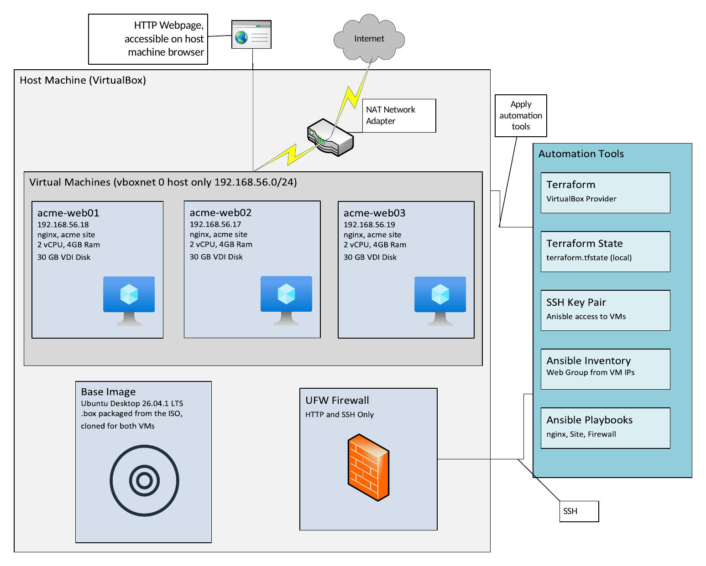

Everything runs on a single Windows 11 host. Each VM has two network adapters: a **host-only** adapter on `vboxnet0` (192.168.56.0/24) used for browser access and Ansible SSH, and a **NAT** adapter used only for outbound package installation. Every VM is cloned from the same prepared base image and protected by a UFW firewall that allows only SSH and HTTP.

### Resource Inventory

| ID | Resource | Type | Purpose | Depends On |
|----|----------|------|---------|------------|
| NET-01 | `vboxnet0` | VirtualBox host-only network (192.168.56.0/24) | Private network for browser access and Ansible SSH | None (created by the VirtualBox installer; DHCP enabled once) |
| NET-02 | NAT adapter | VirtualBox NAT adapter (one per VM) | Outbound internet for package installation | None |
| IMG-01 | `ubuntu-26.04.1-desktop` | Ubuntu Desktop 26.04.1 LTS `.box`, packaged from a prepared VM | Common OS image for every web server | None |
| CMP-01 | `acme-web01` | VM, 2 vCPU, 4 GB RAM (DHCP) | First web server | NET-01, NET-02, IMG-01, STG-01 |
| CMP-02 | `acme-web02` | VM, 2 vCPU, 4 GB RAM (DHCP) | Second, identical web server | NET-01, NET-02, IMG-01, STG-01 |
| CMP-03 | `acme-web03` | VM, 2 vCPU, 4 GB RAM (DHCP) | Third web server, added by raising `web_count` from 2 to 3 | NET-01, NET-02, IMG-01, STG-01 |
| STG-01 | VM disks | VDI, 30 GB per VM | System storage | IMG-01 |
| STG-02 | `/var/www/acme` | Directory on each VM | Site files served by nginx | CMP-*, STG-01 |
| SVC-01 | `terraform.tfstate` | Local Terraform state | Tracks deployed resources for planning and change detection | `terraform apply` |
| SVC-02 | SSH key pair | Public/private key pair | Passwordless Ansible authentication | None |
| SVC-03 | `inventory.ini` | Terraform `local_file` resource | Ansible inventory generated from VM IP outputs | CMP-* |
| SVC-04 | UFW | Host firewall on each VM | Allows only SSH and HTTP | CMP-* |
| APP-01 | Acme intranet site | nginx static site | Internal page served identically by every web server | CMP-*, STG-02, SVC-04 |

---

## Repository Structure

```
acme-lab/
├── ansible/
│   ├── templates/          # Jinja2 templates for the intranet page and nginx site config
│   ├── ansible.cfg
│   ├── inventory.ini       # Generated by Terraform; do not edit by hand
│   └── site.yml            # The playbook that configures every web server
├── docs/
│   └── images/             # Diagrams and screenshots used in this README
├── images/
│   └── ubuntu-26.04.1-desktop-v3.box   # Prepared base image (not committed)
├── terraform/
│   ├── inventory.tftpl     # Template for the generated Ansible inventory
│   ├── main.tf             # Providers, VM resources, and inventory resource
│   ├── outputs.tf          # web_ips, web_urls, inventory_file
│   └── variables.tf        # web_count, cpus, memory, box_path, and more
├── deploy.ps1              # One-command provision → configure → validate workflow
├── .gitignore
└── README.md
```

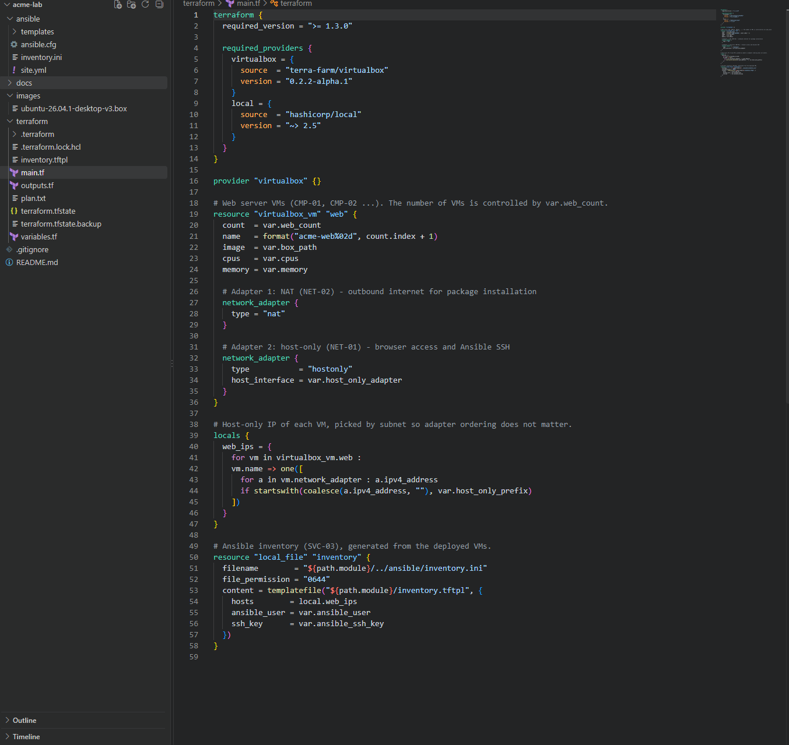

---

## Prerequisites

The workflow runs on a Windows 11 host with Oracle VirtualBox 7.2, Terraform 1.3 or later, and Ansible installed inside a WSL Ubuntu distribution, which acts as the Ansible control node. A few one-time setup steps are also required: a prepared Ubuntu base box that already includes OpenSSH server, Python 3, VirtualBox Guest Additions, passwordless sudo for the admin account, and the project's SSH public key; DHCP enabled on the `vboxnet0` host-only network; and an SSH key pair (`acme_lab`) that Ansible uses to reach the VMs.

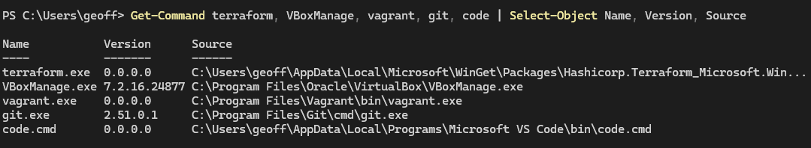

---

## Quick Start

Rebuild the entire environment with one command from PowerShell at the repository root:

```powershell
.\deploy.ps1
```

Or run each stage by hand:

```powershell
# Stage 1: Provision
cd terraform
terraform init
terraform validate
terraform plan
terraform apply
terraform output
```

```bash
# Stage 2: Configure (from WSL)
cd ansible
ansible all -i inventory.ini -m ping
ansible-playbook -i inventory.ini site.yml
```

To scale the web tier, change `web_count` in `terraform/variables.tf`, then run `terraform plan` and `terraform apply` followed by the playbook again. The new server is picked up automatically through the regenerated inventory.

---

## How It Works

### Provisioning with Terraform

Terraform was chosen for provisioning because it manages infrastructure through declarative configuration and state. The configuration uses two providers. The community `terra-farm/virtualbox` provider, pinned to `0.2.2-alpha.1`, clones each VM from the base image and attaches its CPU, memory, and network adapters. It is pinned to an exact version because it is an experimental alpha release, and Terraform will not select a pre-release version unless one is specified explicitly. The `hashicorp/local` provider (`~> 2.5`) writes the Ansible inventory to disk from the addresses of the deployed machines, which is what connects the provisioning and configuration stages.

Every value that could change between environments lives in `variables.tf`, so `main.tf` contains no hard-coded settings. `web_count` sets the number of web servers. `cpus` and `memory` size each VM at two vCPUs and 4 GB, with memory written as `"4.0 gib"` to match the format the provider reports back and avoid false change detection. `box_path` locates the base image using a relative path, because the provider misreads Windows drive letters. `host_only_adapter` and `host_only_prefix` identify the private network and the address range used to pick out each server's host-only IP, and `ansible_user` and `ansible_ssh_key` supply the admin account and private key written into the inventory.

The configuration exposes three outputs. `web_ips` maps each server name to its host-only address, selected by subnet so that adapter ordering does not matter. `web_urls` builds each server's HTTP address from those IPs and is used during validation, and `inventory_file` reports where the generated inventory was written.

```hcl
resource "virtualbox_vm" "web" {
  count  = var.web_count
  name   = format("acme-web%02d", count.index + 1)
  image  = var.box_path
  cpus   = var.cpus
  memory = var.memory

  network_adapter { type = "nat" }                       # outbound packages
  network_adapter {
    type           = "hostonly"                          # browser + Ansible SSH
    host_interface = var.host_only_adapter
  }
}
```

The first deployment was reviewed with `terraform plan`, which proposed three resources to add (two VMs and the inventory file) and nothing to change or destroy. After `terraform apply`, both servers were running with valid host-only addresses, `terraform output` listed each server's address and URL, and a follow-up plan reported no changes, confirming the deployed infrastructure matched the configuration exactly.

| Initialization | Plan | Apply |
|:---:|:---:|:---:|
| 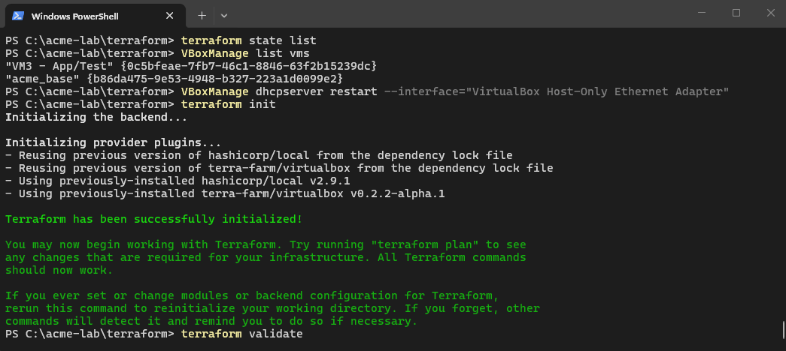 | 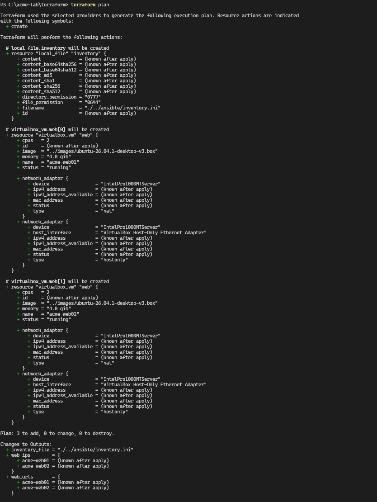 | 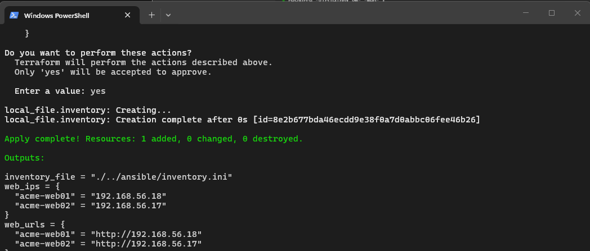 |

<details>
<summary>More provisioning screenshots</summary>

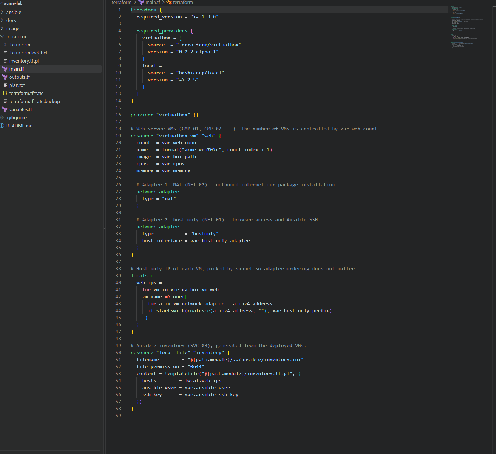
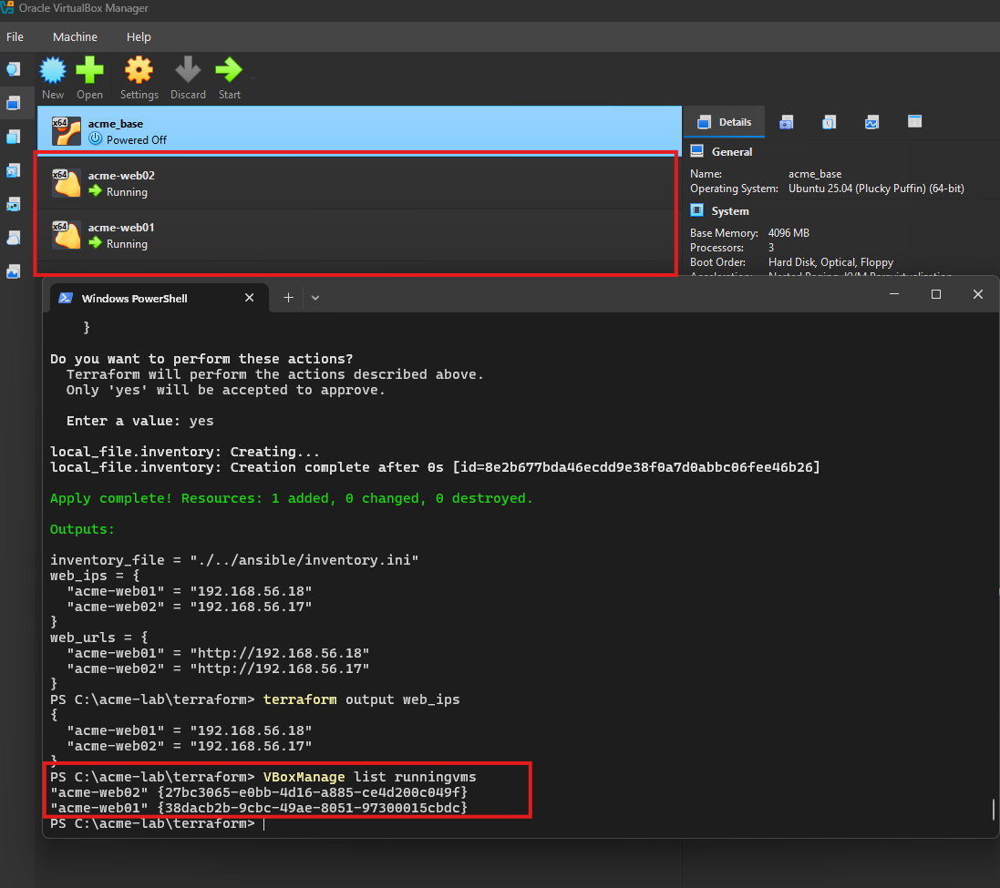

</details>

### State and Change Management

Terraform keeps its state in a local `terraform.tfstate` file that records every managed resource and the attributes it last observed. For each VM, that includes the VirtualBox machine UUID, name, CPU count, memory, power status, and each network adapter's type, MAC address, host interface, and IPv4 address. For the inventory, it holds the file path, content, and checksum. State is what links each resource in the configuration to the real object it created; without it, Terraform could not tell which VirtualBox machines it owns or decide what has changed. On every plan, Terraform refreshes state through the provider and compares three things, the configuration, the recorded state, and the real infrastructure, which lets it create only what is missing, change only what differs, and destroy only what has been removed.

To test this, I scaled the web tier by raising `web_count` from 2 to 3, simulating a business need to add capacity without interrupting the existing servers. I chose scale-out over resizing because the VirtualBox provider could not reliably modify running machines on VirtualBox 7.2.

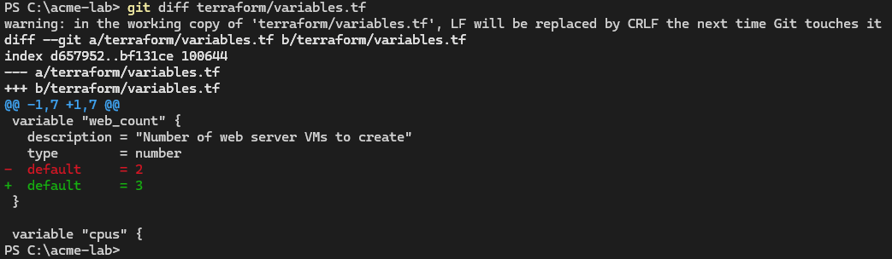

The run turned out to exercise more of Terraform's state handling than expected. Before evaluating the change, Terraform's refresh detected that both existing servers had been powered off outside of Terraform and proposed starting them, which is configuration drift caught by comparing state to reality. After starting them so the plan would reflect only the intended change, Terraform planned to create `virtualbox_vm.web[2]` and regenerate the inventory, with no changes to the existing servers. During apply, the provider aborted while the new machine was still reporting its network addresses, so Terraform marked `acme-web03` as tainted rather than losing track of it. Once the VM finished booting, I untainted it and applied again, Terraform recognized it as healthy, and the updated inventory was written. The original two servers were never modified, and a follow-up plan reported no changes.

| Scale-out Plan | Scale-out Apply | Resulting State |
|:---:|:---:|:---:|
| 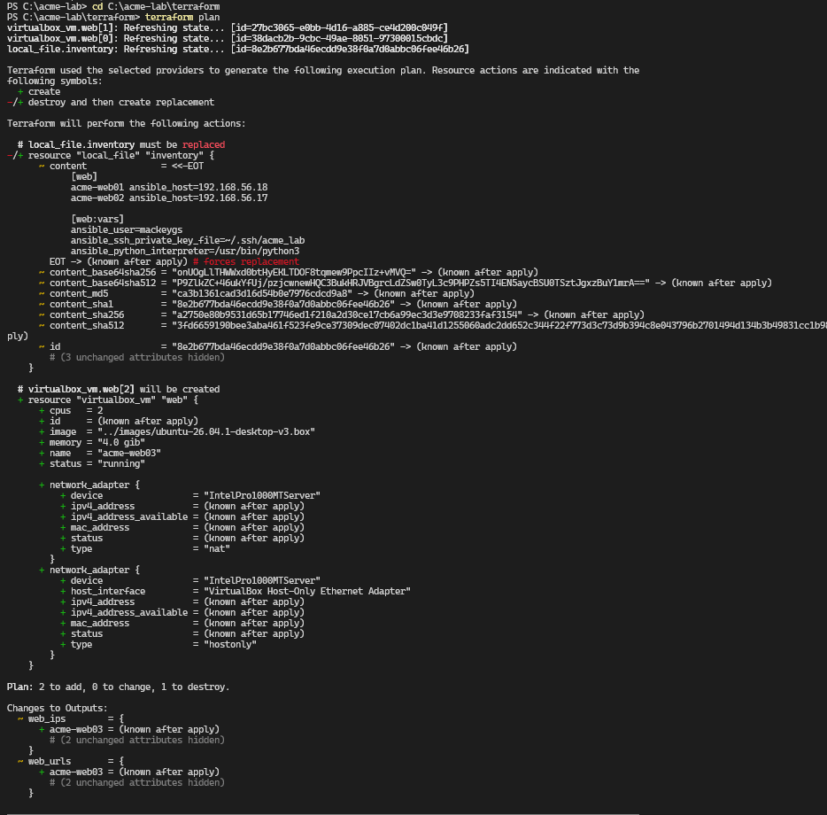 | 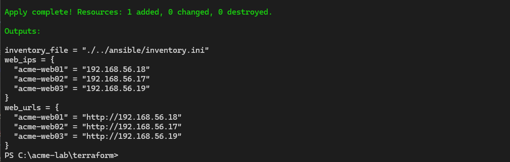 | 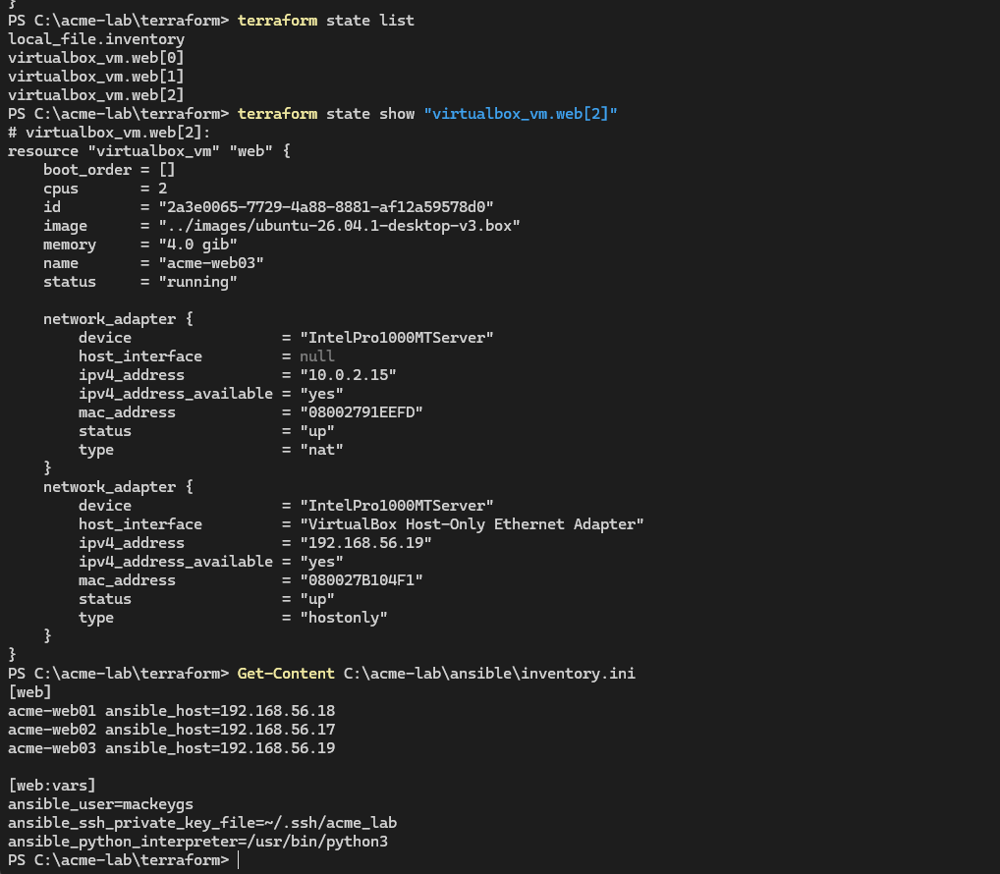 |

<details>
<summary>State before the change</summary>

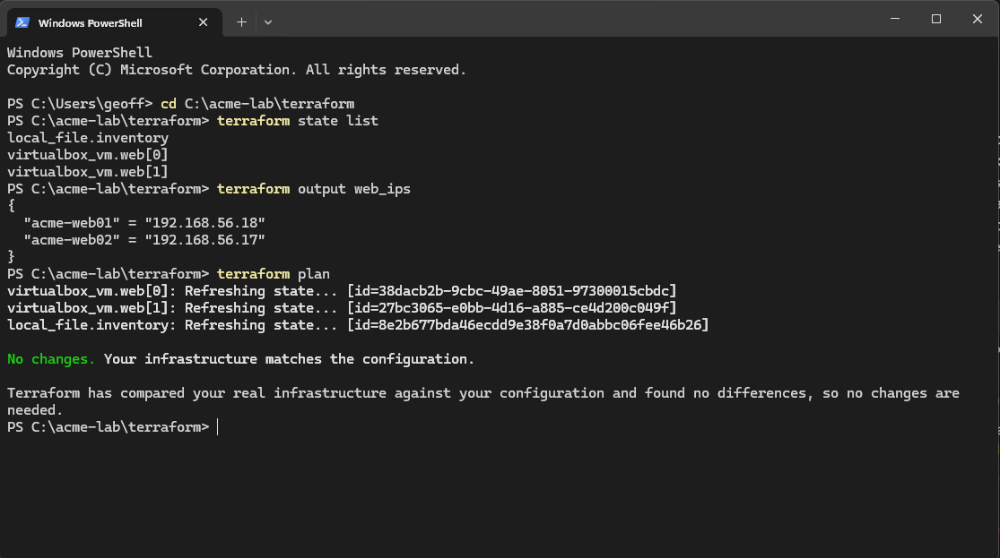

</details>

### Configuration with Ansible

Ansible was chosen for configuration because its agentless model requires only SSH and Python on each managed host, both of which are built into the base image. It runs from a control node in WSL Ubuntu and connects to every server over SSH using the `acme_lab` key.

**Inventory.** The inventory is an INI file generated by Terraform from `inventory.tftpl` every time the infrastructure changes, so it always reflects the servers that actually exist. It defines a single `web` group containing `acme-web01` through `acme-web03`, each paired with its DHCP-assigned `ansible_host` address. A `[web:vars]` section applies the shared connection settings: the admin account, the SSH key path, and the Python 3 interpreter.

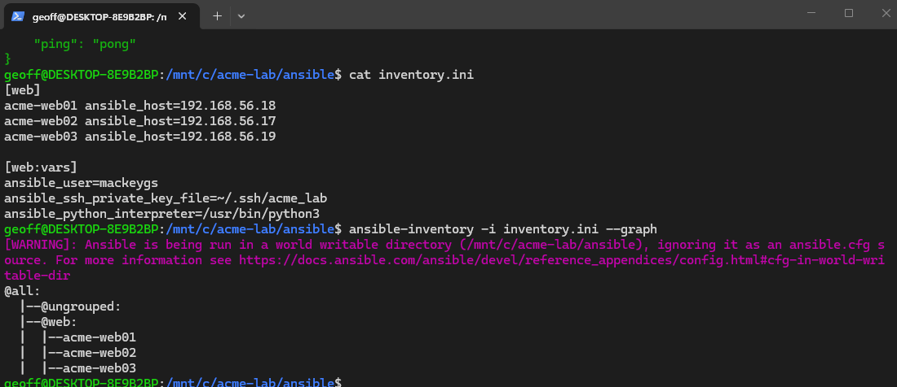

**Playbook.** A single playbook, `site.yml`, turns every host in the `web` group from a freshly cloned Ubuntu system into a working, secured Acme web server. It runs with `become` through the admin account's passwordless sudo and performs its tasks in dependency order. It sets each host's hostname and updates `/etc/hosts` to match, installs nginx and UFW with the `apt` module (refreshing the cache only when it is more than an hour old), and creates `/var/www/acme` owned by the web server account. It then deploys the intranet page from a Jinja2 template that inserts each server's own name and address, deploys a dedicated nginx site configuration from a second template, enables the Acme site, removes the default site, and ensures nginx is running and enabled at boot. Finally, it opens TCP 22 and 80 in UFW and enables the firewall with a default-deny inbound policy. A handler reloads nginx only when its configuration or enabled sites actually change.

The result is that every server reports a unique hostname, serves the Acme intranet page identifying which server delivered it, and accepts connections only on SSH and HTTP.

| Playbook | Execution | Result |
|:---:|:---:|:---:|
| 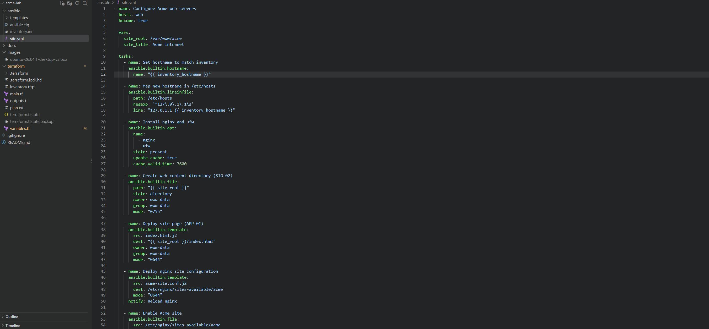 | 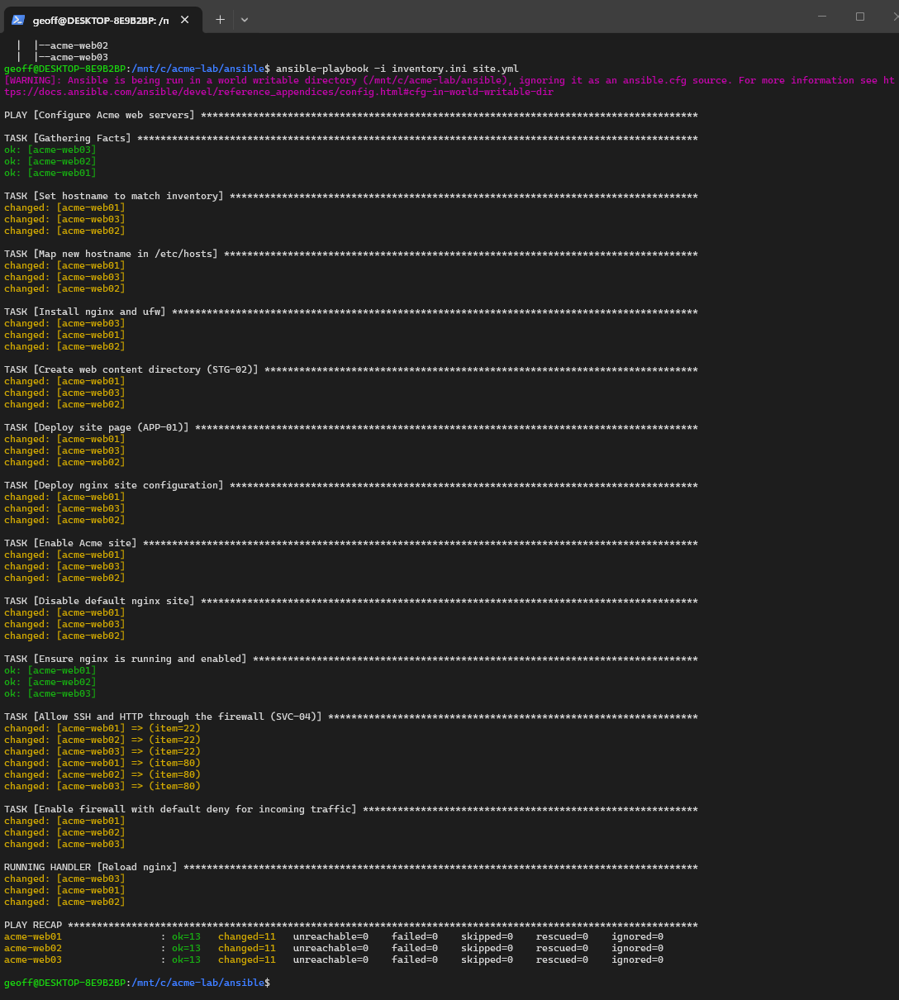 | 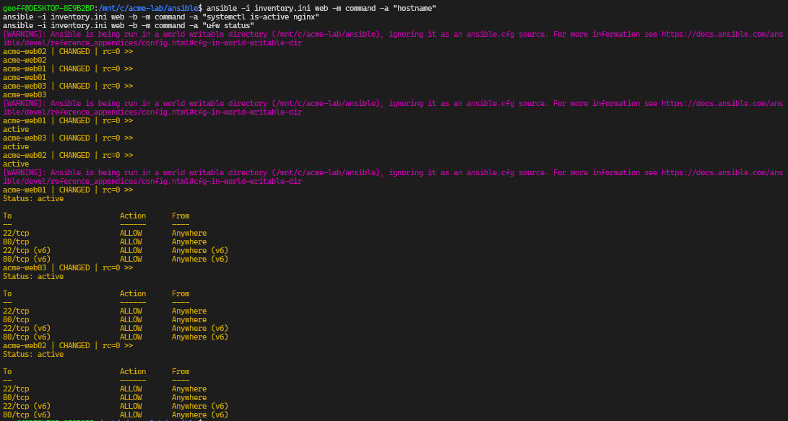 |

<details>
<summary>Independent validation</summary>

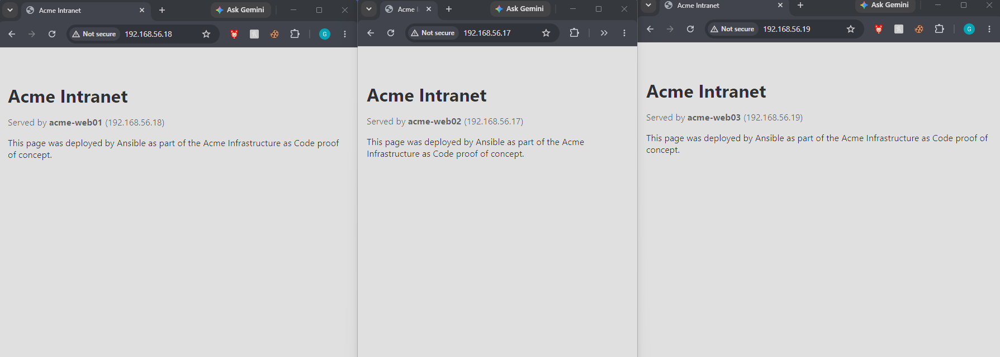

</details>

### Idempotency

On the first run against three freshly provisioned servers, most tasks reported `changed` on every host. Hostnames were set, packages installed, content and configuration deployed, and the firewall enabled, and the `Reload nginx` handler ran once per server. On the second run, with nothing modified in between, every task reported `ok`, the handler did not fire, and the play recap showed `changed=0` on all three hosts.

| First run | Second run |
|:---:|:---:|
| 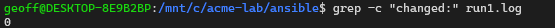 | 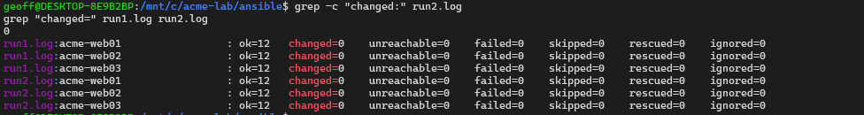 |

This works because each Ansible module compares the desired state in the playbook against the host's actual state before acting, and only makes a change when the two differ. On the second run, the hostname module found the name already set, `apt` found the packages installed and the cache fresh, the file and template modules found matching content and permissions, and the UFW module found the rules already in effect. Because nothing changed, nothing notified the handler, so nginx was never reloaded unnecessarily. In practice, this means the same playbook can configure a new server, correct drift on an existing one, or simply audit compliance, all without disrupting systems that are already correct.

<details>
<summary>Full idempotency run output</summary>

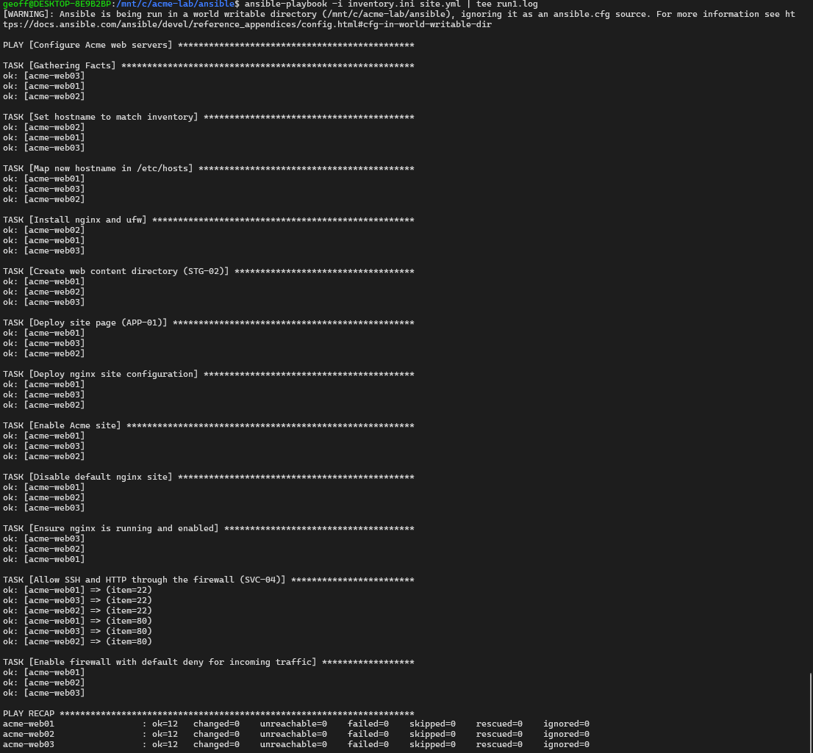
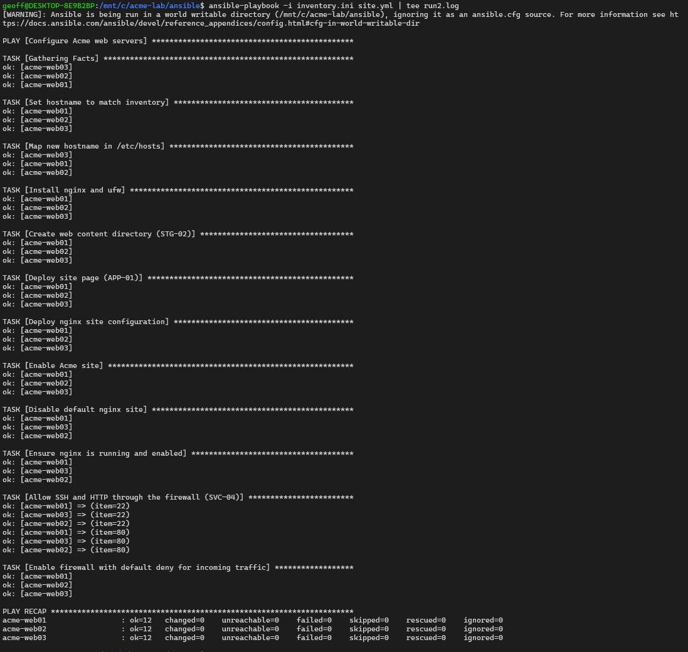

</details>

### The Integrated Workflow

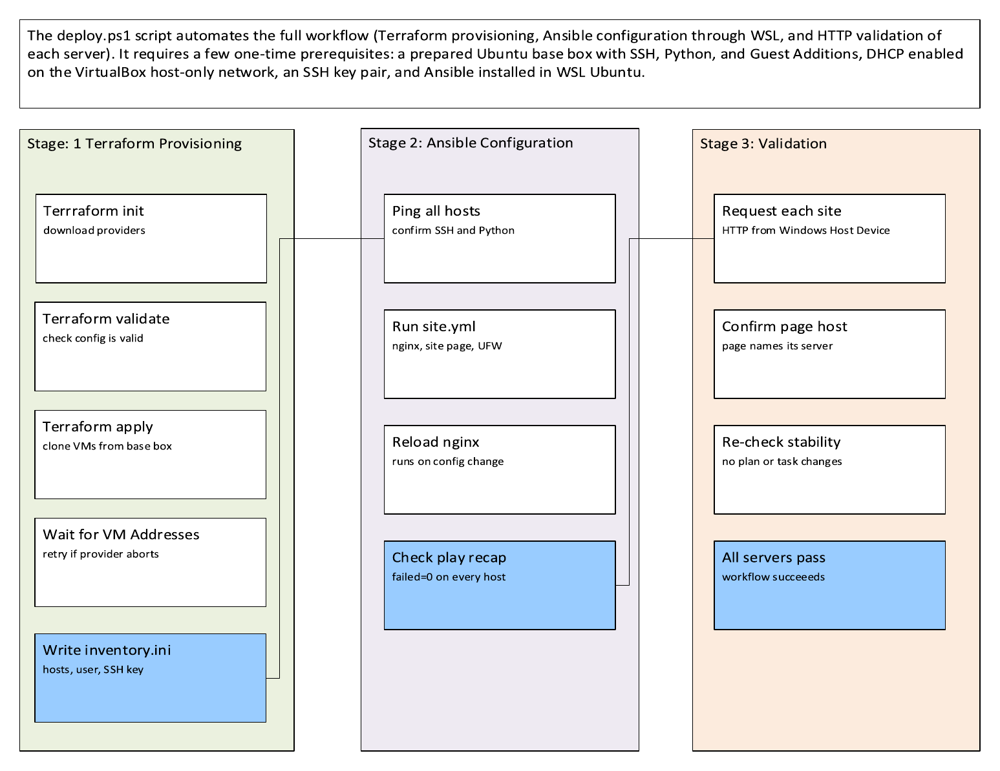

`deploy.ps1` runs three stages in strict order, with each stage starting only after the previous one succeeds. In the first stage, Terraform initializes, validates, and applies the configuration, cloning the VMs and writing the inventory from their addresses. In the second, Ansible runs inside WSL, confirms connectivity to every host with a ping, and executes `site.yml`. In the third, the script requests each server's page from the Windows host and confirms that every server responds and correctly identifies itself.

Responsibilities are divided cleanly by layer. Terraform owns the infrastructure: which machines exist, their resources, network adapters, and state. Ansible owns everything inside those machines: hostnames, packages, configuration files, services, and firewall rules. The script owns neither; it only orders the stages, recovers from the provider's known timing fault, and reports the result.

The two tools are integrated through a single generated artifact, the inventory. Because DHCP addresses change between deployments, generating the inventory from live state guarantees that Ansible always targets exactly the machines Terraform manages, which is how `acme-web03` was configured without any change to the playbook. The script retries only the Terraform stage: when the VirtualBox provider aborts before a new VM has reported its addresses, the script waits for every guest to report, untaints the machines, and applies again, up to three times. Ansible or validation failures stop the run immediately, because those indicate genuine configuration problems.

Validation happens at three levels. Terraform's plan and apply output confirm the infrastructure, Ansible's ping and play recap confirm reachability and configuration, and the script's HTTP checks confirm, independently of both tools, that every server is serving the correct page.

| Terraform Stage | Ansible Stage | Final Validation |
|:---:|:---:|:---:|
| 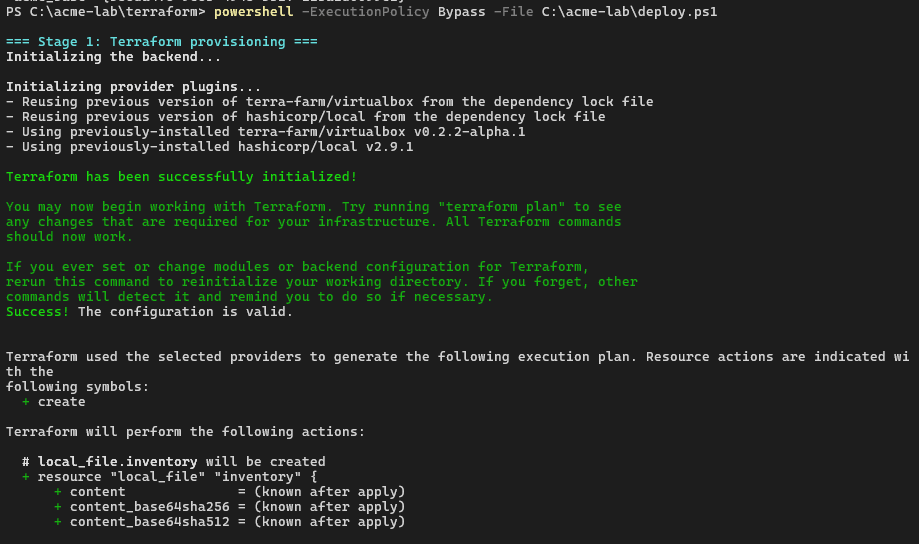 | 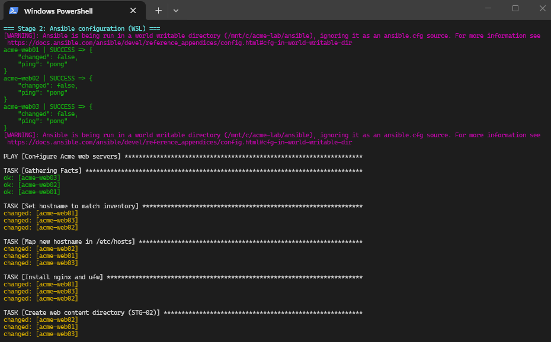 | 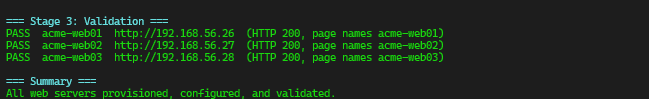 |

<details>
<summary>Terraform outputs and the fully configured environment</summary>

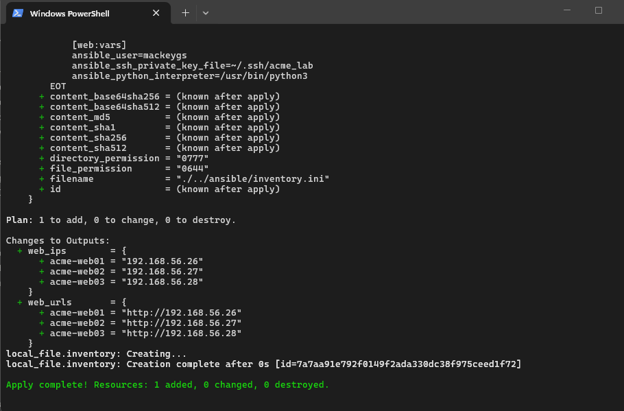
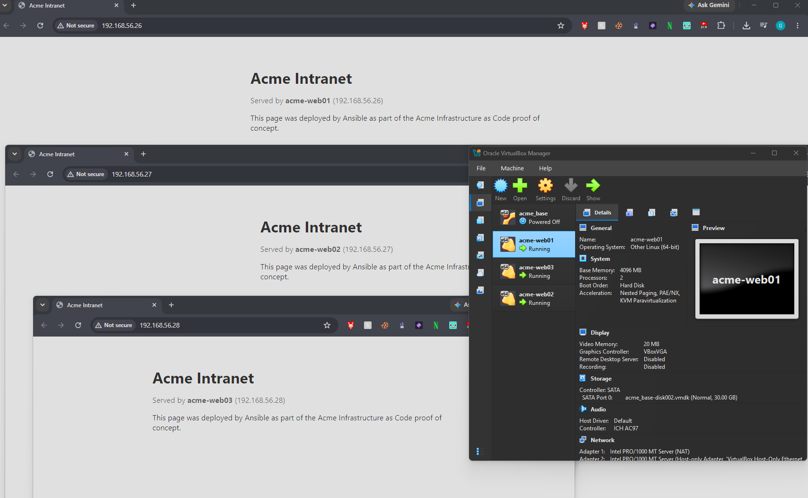

</details>

---

## Challenges and Troubleshooting

Most of the difficulty came from the experimental VirtualBox provider and from preparing a reliable base image, rather than from Terraform or Ansible themselves.

The provider misread Windows paths to the base image, which I worked around by using a relative `box_path`. It also aborted when newly booted machines had not yet reported their network addresses, which is why `deploy.ps1` includes a wait, untaint, and re-apply loop. It could not modify existing machines on VirtualBox 7.2, which shaped the choice of scale-out over resizing for the change scenario.

The base image was originally built from an existing VM and carried leftover Docker interfaces, a static IP address, and NetworkManager profiles tied to its original adapters. All of these had to be found and removed before cloned VMs would report their addresses correctly.

Reviewing every plan before applying caught two mistakes that would otherwise have hit running servers. A typo in `variables.tf` produced a plan to set memory to `"4096 gib"`, roughly four terabytes, and a formatting mismatch between `"4096 mib"` and `"4.0 gib"` produced a plan for in-place changes to values that were actually identical. Other smaller issues included DHCP assigning new addresses on every rebuild (solved by generating the inventory), an occasional clone whose network adapter failed on first boot, and the quirks of running Ansible from WSL against a Windows-hosted hypervisor.

---

## What I Learned

The most valuable concept was state, and how Terraform uses it to compare the desired configuration against what actually exists. Before this project, deploying infrastructure felt like a sequence of steps to perform. Working with state reframed it as declaring a result and letting the tool work out the minimum change needed to reach it. That one idea explained nearly everything I observed: why scaling to three servers added only one machine, why servers powered off outside of Terraform showed up as drift, why a failed creation was tracked as tainted rather than lost, and why a cosmetic difference in a memory value registered as a change. The same principle underlies Ansible's idempotency, which is what tied the whole project together.

I also came away with a clear sense of where each tool belongs. Terraform is excellent at creating and tracking infrastructure but has no reliable way to manage what runs inside a machine, while Ansible is excellent at configuring operating systems and applications but is not designed to track infrastructure lifecycle. Used together, with the inventory as the hand-off, they automate the full path from an empty host to a working, validated service. Finally, the troubleshooting made it clear that a large share of real automation effort goes into making the underlying platform predictable, and that a provider's maturity matters a great deal when choosing tools for production.

---

## Production Hardening Roadmap

This environment was intentionally simplified for an isolated lab. The SSH key has no passphrase, host key checking is disabled, every server shares the base image's host keys, state is a single local file, and the provider is an experimental community release. Taking this pattern to production would mean the following changes.

| Area | Lab Setup | Production Approach |
|------|-----------|---------------------|
| Provider | Experimental `terra-farm/virtualbox` alpha | Mature, officially supported provider (VMware vSphere or a major cloud) |
| State | Local `terraform.tfstate` | Remote backend with locking and versioning |
| Base image | Manually prepared VM packaged as a `.box` | Automated image builds with Packer |
| SSH keys | No passphrase, shared host keys | Passphrase-protected keys or short-lived SSH certificates, unique host keys per VM |
| Host key checking | Disabled | Enabled |
| Change process | Run from a workstation | Version control with a reviewed CI/CD deployment pipeline |
| Tooling | Terraform | Terraform or its open-source counterpart, OpenTofu |
| Availability | Single host, no load balancer | Load-balanced web tier across redundant hosts |

With those safeguards in place, the combination of Terraform and Ansible offers a faster, safer, and more auditable way to manage infrastructure than building servers by hand.

---

## Author

**Geoffrey Mackey**, Cybersecurity Professional & Student at the University of Cincinnati.
